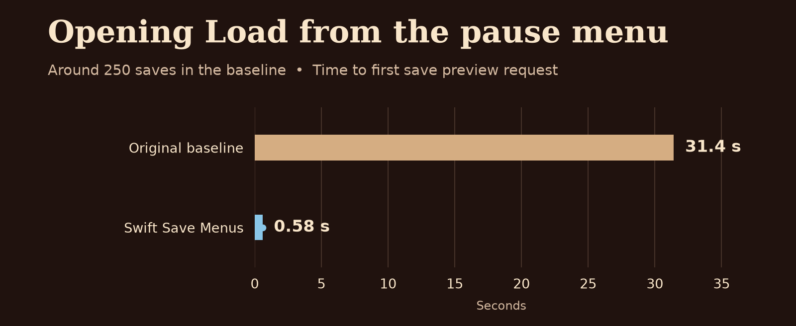
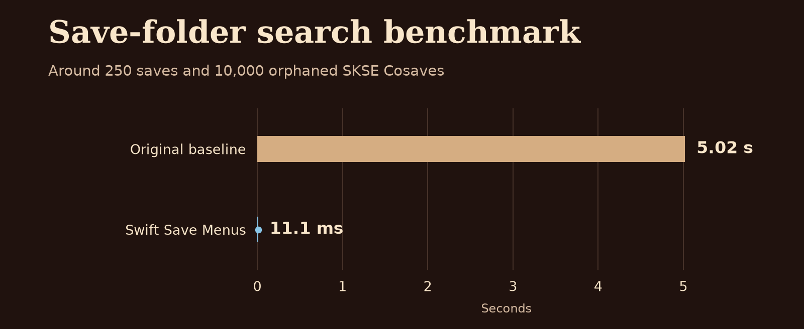

# Swift Save Menus

Swift Save Menus speeds up Skyrim's Save and Load menus at the title screen and in the pause menu. It can also clean up orphaned SKSE Cosaves in the background.

## Performance example

Skyrim searches the save folder before it can show the Save or Load list. As saves build up across one or more playthroughs, that search can take longer. The menu can appear to stall before you can pick a save to load or create a new one.

The in-game comparison measures from opening **Load** to Skyrim's first request for a save preview. The baseline search found around 250 saves.

Mod Organizer 2's virtual filesystem can add overhead when Skyrim lists the folder. Rotating autosaves can also leave behind old SKSE Cosaves when their matching saves are replaced or removed. Those files can pile up even if the number of visible autosaves stays the same, adding more work to the search.

The separate folder-search benchmark times only how long it takes to find the save files. Both runs used the same test folder with the stale SKSE Cosaves left in place.

[How the timings were measured](docs/save-pipeline.md#performance-reference)

## Requirements

Install the same Swift Save Menus ZIP with your mod manager for supported versions of Skyrim Special Edition, Anniversary Edition, and Skyrim VR. Use the SKSE and Address Library downloads that match your game version. Skyrim VR uses SKSE VR and VR Address Library. [Supported versions and required downloads](docs/configuration.md#requirements)

## Configuration

When cleanup is enabled, Swift Save Menus checks for orphaned SKSE Cosaves in the background at startup and again after saves. By default it deletes eligible orphans. You can keep backups instead or turn cleanup off.

With the optional SKSE Menu Framework, open **Swift Save Menus → Settings** in game. Changes take effect immediately and are saved for next time. You can also edit `SwiftSaveMenus.ini` before launching Skyrim. [Settings and backup recovery](docs/configuration.md#settings)

## Recommended save mods

- Schedule and rotate autosaves with [Auto Saver](https://www.nexusmods.com/skyrimspecialedition/mods/126776).
- Reduce pauses while saving with [Seamless Saving - Skyrim Save Accelerator](https://www.nexusmods.com/skyrimspecialedition/mods/173161).
- Speed up SKSE Cosave reads and writes with [Save & Load Accelerator for SKSE Cosaves](https://github.com/just-harry/save-load-accelerator-for-skse-cosaves/releases).
- If you use SkyUI, fix flashing entries in its save list with [SkyUI SE - Flashing Savegames Fix](https://www.nexusmods.com/skyrimspecialedition/mods/20406).

For development, see the [contributor guide](docs/contributor.md).
